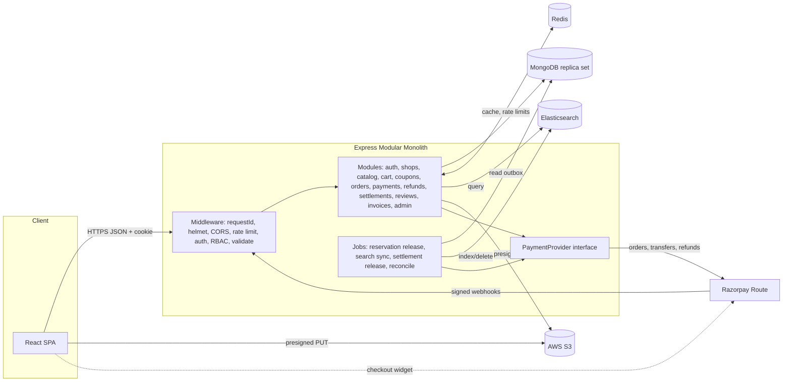

# ARCHITECTURE.md

## 1. Components and responsibilities

| Component                      | Responsibility                                                                                                                                   |
| ------------------------------ | ------------------------------------------------------------------------------------------------------------------------------------------------ |
| React SPA                      | UI only. Holds access token in memory. Opens provider checkout widget with server-created provider order ID. No secrets, no price computation    |
| API (Express modular monolith) | Auth, RBAC, business rules, price/commission computation, transactions, provider calls, webhooks                                                 |
| MongoDB                        | Source of truth for all durable data (incl. outbox, webhook log)                                                                                 |
| Elasticsearch                  | Derived product search index. Rebuildable from Mongo at any time                                                                                 |
| Redis                          | Disposable: cache, rate-limit counters. Nothing stored only in Redis                                                                             |
| S3                             | Product/shop images (client uploads via presigned URL)                                                                                           |
| Payment provider               | Razorpay Route: collects payment, splits to vendor linked accounts, refunds, settlement                                                          |
| Background jobs (in-process)   | reservation release, search sync, settlement release, reconciliation. Guarded by Mongo lease (`jobLocks`) so multiple instances don't double-run |

## 2. Architecture diagram

## 3. Key data flows

### 3.1 Checkout and payment

1. `POST /checkout` (header `Idempotency-Key`). Server loads cart, re-reads current prices/stock, validates coupon, computes totals and per-vendor commission.
2. **Mongo transaction:** conditional stock decrement per item (`stockQty >= qty`), coupon reservation (conditional `usedCount` increment), create `Order(pending_payment, reservationExpiresAt = now+15m)`, `SubOrder`s (one per vendor), `Settlement`s (`not_eligible`), `Payment(created)`, clear cart.
3. After commit: `PaymentProvider.createOrder(totalPaise, transfers[])` where each transfer = vendor payout for one sub-order, **on hold** (verify V2). Save `providerOrderId`. If the provider call fails: run the compensation (expire order, release stock/coupon) and return 502.
4. Client opens the provider widget with `providerOrderId` and the public key id.
5. **Confirmation paths (all call `markOrderPaid`):** (a) `POST /payments/verify`: verify HMAC signature, then fetch the payment from the provider and confirm `captured`, amount, currency; (b) webhook; (c) reconciliation job for `pending_payment` orders older than 5 min.
6. `markOrderPaid` = conditional update `status: pending_payment → placed, paymentStatus: unpaid → paid` (idempotent: second caller matches 0 docs and returns the current state). Sets sub-orders `pending_payment → processing`, redeems coupon reservation, invalidates caches.
7. **Late capture on expired order:** if the order is already `expired`, attempt to re-reserve stock in a transaction. On success, proceed. On failure, auto-refund in full and log an audit event.

### 3.2 Webhooks

`POST /webhooks/razorpay` uses a raw-body parser, verifies the signature before parsing, inserts `webhookEvents{provider,eventId}` (unique index; duplicate key → return 200 and stop), processes, marks processed, and responds 200 fast. Failures leave `status=failed` for retry by reconcile. Amount and currency are always checked against the DB. Event content is never trusted for privileged decisions without a provider API fetch for payment state.

### 3.3 Fulfillment

Vendor `PATCH /vendor/sub-orders/:id/status` along an allowed transition table (see API_CONTRACTS). `delivered` sets `deliveredAt` and `returnWindowEndsAt = +7d`, and sets the settlement to `pending_release`. Order becomes `completed` when all sub-orders are `delivered` or `cancelled`.

### 3.4 Refunds

Customer may cancel a sub-order before `shipped`; admin may refund any sub-order (full/partial) within the window. Flow: create `Refund(initiated)` (idempotent by key) → provider refund (reverse the vendor transfer, V2) → webhook/fetch marks `processed` → restore stock if cancelled-before-ship → recompute settlement. Commission is reversed proportionally (see DECISIONS D9).

### 3.5 Settlement

States: `not_eligible → pending_release → released → settled` (+ `reversed`, `failed`). Hourly job releases the provider hold for settlements with `returnWindowEndsAt <= now`, no open refund, and vendor payout account `active`. Provider settlement webhook/fetch moves to `settled`. A daily reconciliation job compares local settlement totals against provider transfers and writes a `reconciliationReports` document.

### 3.6 Search synchronization (Mongo → Elasticsearch)

- Every product create/update/stock-crossing-zero/status change writes a `searchOutbox` entry **in the same transaction** as the product write.
- A job (every 2 s, lease-guarded) claims entries, bulk-indexes using `version = product.updatedAt millis` with `version_type=external` (stale writes rejected), deletes the outbox entry on success; on failure increments `attempts` with backoff; entries over 10 attempts are flagged for admin attention.
- Indexed doc = only public, searchable fields of `active` products from `approved` vendors. Vendor suspension enqueues all that vendor's products.
- `POST /admin/search/reindex` (and `npm run reindex`) rebuilds an index behind an alias and swaps atomically.
- Search failure behaviour: `/products/search` falls back to a Mongo text-index query with reduced features and header `X-Search-Fallback: mongo`.

### 3.7 Image upload

Vendor requests `POST /vendor/uploads/presign` (content-type allowlist jpeg/png/webp, max 5 MB, vendor-scoped key `products/{vendorId}/{uuid}.ext`) → client PUTs directly to S3 → product save stores the key. Backend verifies key prefix matches vendor ID. Bucket blocks listing; public read only on `products/*` (verify).

## 4. Redis usage

| Use             | Key pattern                         | TTL    | Invalidation                                                         | Failure behaviour                                                                                                  |
| --------------- | ----------------------------------- | ------ | -------------------------------------------------------------------- | ------------------------------------------------------------------------------------------------------------------ |
| Product detail  | `cache:product:{slug}`              | 5 min  | Delete on product update/status/stock change/review aggregate change | Fail-open: read Mongo                                                                                              |
| Category tree   | `cache:categories`                  | 1 h    | Delete on admin category change                                      | Fail-open                                                                                                          |
| Search results  | `cache:search:{hash(query)}`        | 60 s   | TTL only (no invalidation, accepted staleness)                       | Fail-open                                                                                                          |
| Admin analytics | `cache:analytics:{endpoint}:{hash}` | 5 min  | TTL only                                                             | Fail-open                                                                                                          |
| Rate limits     | `rl:{scope}:{key}`                  | window | n/a                                                                  | General limiter fails open to in-memory per-process limiter; auth limiter falls back to in-memory (never disabled) |

Rules: cache never holds stock, prices used at checkout, or order/payment data. Checkout always reads Mongo. All cache calls have 100 ms timeout; errors are logged at `warn`, never thrown to the user.

## 5. Inventory and concurrency rules

- `stockQty` = sellable quantity. Decrement at checkout via `findOneAndUpdate({_id, status:'active', stockQty:{$gte:qty}}, {$inc:{stockQty:-qty}})` inside the transaction; a null result aborts with `OUT_OF_STOCK` (409) naming the product.
- Reservation expiry job (every 60 s): find `pending_payment` orders with `reservationExpiresAt < now`, transition each to `expired` with a conditional update, then (same transaction) increment stock back and release the coupon reservation. Idempotent by status guard.
- Cancel/refund-before-ship restores stock once (guarded by `stockRestored` flag on sub-order).
- Order creation retried with same `Idempotency-Key` returns the original order.
- Vendor stock edits use absolute-set or `$inc` with guard `stockQty >= 0`.

## 6. Authorization design

- `authenticate` verifies the access JWT (HS256 for MVP, 15 min; claims: `sub`, `role`, `vendorId?`). `authorize(...roles)` gates routes.
- **Vendor ownership:** `vendorId` is derived from the authenticated user's vendor record, never from request body/params. All vendor queries include `{ vendorId }`; fetch-by-id uses `{ _id, vendorId }` and returns **404** (not 403) when absent, preventing existence leaks.
- Customer resources scoped by `customerId = req.user.id`.
- Vendor must be `approved` to publish products or receive orders; suspended vendors' products are de-indexed.
- Admin routes require `role=admin`; every admin mutation writes `auditLogs`.

## 7. Auth sessions

Access token in memory (JS). Refresh token: random 256-bit, stored hashed in `refreshTokens` with `familyId`; httpOnly, Secure cookie, path `/api/v1/auth`; rotated on every use; reuse of a rotated token revokes the whole family. Cross-site cookie specifics: `SameSite=None; Secure` if domains differ (verify V5), plus Origin allowlist check on `/auth/refresh` and `/auth/logout`.

## 8. Cross-cutting

- **Validation:** Zod schemas per route (`body`, `query`, `params`), `.strict()` to reject unknown keys (blocks NoSQL operator injection).
- **Rate limiting (Redis store):** global 300/15 min/IP; login 10/15 min per IP+email; register 5/hour/IP; checkout 10/min/user; search 60/min/IP; presign 30/hour/vendor.
- **Security:** helmet, strict CORS allowlist with credentials, body limit 100 kB (webhook raw-body route separate), bcrypt, generic login errors, `Idempotency-Key` on checkout, signature checks on webhooks, secrets only in env, dependency audit in CI.
- **Errors:** `AppError(code, status, message, details)`; central handler maps Zod/Mongoose/duplicate-key errors; stacks never returned in production; unknown errors → `INTERNAL_ERROR` 500 with `requestId`.
- **Logging:** pino JSON, `requestId` per request, redact `authorization`, `cookie`, `password*`, tokens; log provider IDs, never card data (none touches the server). Business events (order placed, payment marked, refund, settlement transition) logged at `info`.
- **Health:** `GET /health` (liveness), `GET /health/ready` (Mongo required; ES/Redis reported as degraded, not fatal).

## 9. Deployment topology

Frontend: static host (SPA fallback rewrite). Backend: single Node service with env config; Mongo Atlas replica set; ES/Redis hosting TBD (V4); S3 + CORS for presigned PUT from the frontend origin. Scale-out is possible because jobs use leases and sessions are stateless.
